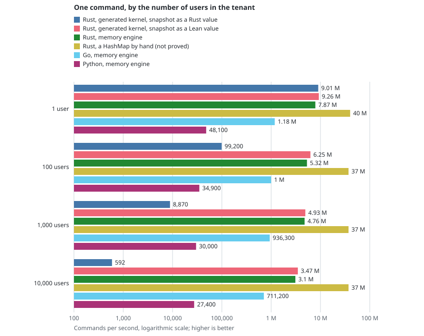
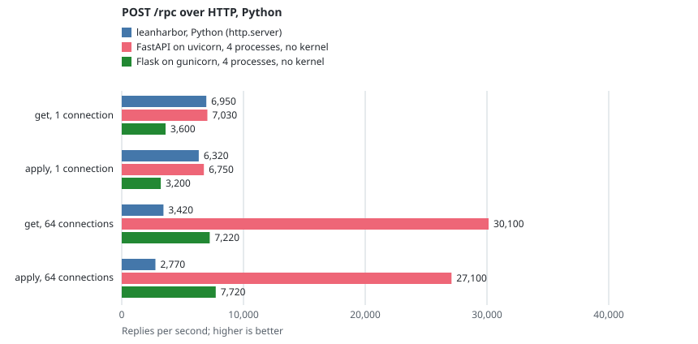

# leanharbor

Web services whose core is one pure function written and proved in Lean 4.

You write the kernel of a service — what a command does to one tenant's state — as a Lean
function, prove what callers rely on, and [leanfran](https://github.com/conao3/lean-leanfran)
generates it to your language. leanharbor is the contract the kernel fills and the shell that
runs the generated code behind HTTP. The same kernel runs today from Rust, from Python and from Go.

The design follows [h5i-app](https://github.com/h5i-dev/h5i/blob/main/crates/h5i-app/README.md),
which does this for Rust by translating Rust to Lean. leanharbor goes the other way: Lean is the
source, and the host language is generated.

## The calculator

[`lean/Calculator/Kernel.lean`](lean/Calculator/Kernel.lean) keeps one number per user:

```lean
def transition (actor : Principal) (snap : Snapshot) (cmd : Command) :
    Except Error (Option Memory × Reply) :=
  match cmd with
  | .set value => .ok (some { user := actor.user, value }, .value value)
  | .apply op arg =>
    match compute op (memoryOf snap.memories actor.user) arg with
    | .ok v => .ok (some { user := actor.user, value := v }, .value v)
    | .error e => .error e
  | .get => .ok (none, .value (memoryOf snap.memories actor.user))
```

A tenant's numbers are a binary trie on the user id, lowest bit first. A command visits at most
64 nodes, and about log₂ n in a tenant whose n user ids are 0 to n − 1. `memoryOf` reads a number and `apply` stores one with `store`.

[`lean/Calculator/Proofs.lean`](lean/Calculator/Proofs.lean) proves, for every principal, snapshot
and command:

| Theorem | Statement |
|---|---|
| `transition_spec` | the reply is `specStep` (arithmetic on unbounded naturals) of the caller's number, and the command is refused exactly when `specStep` refuses |
| `compute_spec` | `compute` is `+`, `-`, `*`, `/` on naturals when the result fits 64 bits, and a refusal otherwise |
| `get_after` | after an accepted command, `get` by the same user returns that command's reply |
| `others_unchanged` | a command leaves every other user's number as it was |
| `read_only_sound` | `get` returns no writes |
| `memoryOf_store` | after `store k v`, `memoryOf` returns `v` for `k` and what it returned before for every other id |

The Rust server is the generated kernel behind an ordinary axum router
([`rust/calculator`](rust/calculator)):

```console
$ export LEANHARBOR_SECRET=dev-secret
$ TOKEN=$(LEANHARBOR_ISSUE=1:7 cargo run --release -q --bin leanharbor-calculator)
$ LEANHARBOR_LISTEN=127.0.0.1:8080 cargo run --release -q --bin leanharbor-calculator &
$ curl -s -H "Authorization: Bearer $TOKEN" -d '{"cmd":"set","value":6}' 127.0.0.1:8080/rpc
{"value":6}
$ curl -s -H "Authorization: Bearer $TOKEN" -d '{"cmd":"apply","op":"mul","arg":7}' 127.0.0.1:8080/rpc
{"value":42}
$ curl -s -H "Authorization: Bearer $TOKEN" -d '{"cmd":"get"}' 127.0.0.1:8080/rpc
{"value":42}
$ curl -s -H "Authorization: Bearer $TOKEN" -d '{"cmd":"apply","op":"div","arg":0}' 127.0.0.1:8080/rpc
{"error":"division_by_zero"}
```

The Python server ([`python/src/leanharbor_calculator`](python/src/leanharbor_calculator)) runs
the same Lean module, generated to Python, and the Go server
([`go/calculator`](go/calculator)) runs it generated to Go. Accepted and refused commands get the
same status and body from the three servers, and a token issued by one is accepted by the others:

```console
$ cd python && LEANHARBOR_LISTEN=127.0.0.1:8081 uv run leanharbor-calculator &
$ curl -s -H "Authorization: Bearer $TOKEN" -d '{"cmd":"set","value":6}' 127.0.0.1:8081/rpc
{"value":6}
$ cd go && LEANHARBOR_LISTEN=127.0.0.1:8082 go run ./calculator/cmd/leanharbor-calculator &
$ curl -s -H "Authorization: Bearer $TOKEN" -d '{"cmd":"set","value":6}' 127.0.0.1:8082/rpc
{"value":6}
```

## What is proved, and what is trusted

Proved in Lean, about the definitions that are generated and run:

- the six theorems above, for the calculator kernel. The three shells call `transition` and
  `apply`;
- `Leanharbor.Kernel.Run.inv`: a property that holds for the initial snapshot and is kept by
  every accepted command holds in every snapshot a tenant can reach.

Checked by `make check`, not proved:

- **The theorems constrain the kernel.** [leanassay](https://github.com/conao3/lean-leanassay)
  breaks `transition`, `apply`, `compute` and the three functions of the trie in 167 small ways
  and runs the theorems on each broken version: 132 are rejected, 5 behave the same on every
  input tried, 30 do not compile, and none satisfies every theorem while changing an output.
- **The generated code computes what Lean computes.** 5,000 commands (698 refusals, values up
  to 2^64 − 1) run through the generated Rust, the generated Python and the generated Go give the
  same output as the kernel compiled natively by Lean.
- **The code that runs is generated from the proved source.** The build regenerates the three
  targets and fails on a difference from the committed files.
- **No extra axioms.** Every theorem depends only on `propext`, `Classical.choice` and
  `Quot.sound`.

Trusted, with no theorem. The Rust, Python and Go shells are written by hand, and every row
holds for each of them:

| | Trusted |
|---|---|
| Translation | leanfran's Rust, Python and Go backends and their runtimes, rustc, CPython, the Go compiler, Lean's kernel |
| Engine | the memory engine: one command at a time per process, under one lock; replies stored per idempotency key |
| Authentication | the token format and its parser, HMAC-SHA256, the secret and its storage, the system clock |
| Wire format | JSON decoding of commands and encoding of replies and refusals (`Api`) |
| HTTP | axum, hyper and tokio (Rust); `http.server` (Python); `net/http` (Go) |
| Specification | that `specStep` and the statements above say what a calculator should do |

State lives in the server's memory and is lost on restart. PostgreSQL storage with proved SQL
generation and tenant isolation, and proved authorization guards are designed and not yet built.

## Speed

Measured on a cloud VM with 4 virtual CPUs (Intel Xeon, 2.10 GHz) and 16 GB of memory by
`tools/measure.py`, which runs every measurement alone and writes the runs to
[`docs/speed.json`](docs/speed.json). `tools/speed-charts.py` draws the charts and prints the
tables from that file. Every number is a rate, so higher is better. All numbers come from one
run of the program: the same measurement on another VM of this kind differs by up to 2 times, so
compare rows within this section only.

### One command through the kernel

Commands per second through `transition` and `apply`. Each cell is the inverse of the median
time of three runs; the runs of one cell differ by up to 1.3 times. M is a million.



| Commands per second | 1 user | 100 users | 1,000 users | 10,000 users |
|---|---:|---:|---:|---:|
| Rust, generated kernel, snapshot as a Rust value | 6.37 M | 271,700 | 24,400 | 1,850 |
| Rust, generated kernel, snapshot as a Lean value | 9.8 M | 2.73 M | 290,300 | 25,500 |
| Rust, memory engine | 7.87 M | 2.73 M | 357,800 | 37,600 |
| Rust, the same logic by hand (not proved) | 90.9 M | 23.8 M | 5.43 M | 621,900 |
| Go, memory engine | 726,200 | 532,800 | 124,200 | 3,320 |
| Python, memory engine | 47,300 | 22,300 | 3,120 | 297 |

### Over HTTP, next to servers without a kernel

Replies per second to `POST /rpc` on the same VM, with `oha` for 8 seconds against a tenant of
one user. Each cell is the mean of two runs, and every reply had status 200. The load generator
runs on the same four CPUs as the server.

The servers marked "no kernel" ([`bench/`](bench)) are the usual servers of each language doing
the least a JSON endpoint does: they decode the JSON body and reply with a JSON value. They check
no token, hold no state and call no kernel, so the difference from a leanharbor row is what the
token check, the engine and the generated kernel cost.


| Replies per second, Rust | get, 1 connection | apply, 1 connection | get, 64 connections | apply, 64 connections |
|---|---:|---:|---:|---:|
| leanharbor, Rust (axum) | 17,100 | 16,800 | 128,000 | 120,800 |
| axum, no kernel | 18,300 | 18,300 | 141,900 | 137,800 |
| actix-web, no kernel | 18,800 | 18,600 | 191,200 | 188,900 |


| Replies per second, Go | get, 1 connection | apply, 1 connection | get, 64 connections | apply, 64 connections |
|---|---:|---:|---:|---:|
| leanharbor, Go (net/http) | 10,900 | 9,950 | 68,700 | 62,500 |
| net/http, no kernel | 12,200 | 10,900 | 90,200 | 87,400 |
| gin, no kernel | 11,800 | 12,000 | 74,700 | 70,600 |



| Replies per second, Python | get, 1 connection | apply, 1 connection | get, 64 connections | apply, 64 connections |
|---|---:|---:|---:|---:|
| leanharbor, Python (http.server) | 5,960 | 5,350 | 2,940 | 2,470 |
| FastAPI on uvicorn, 4 processes, no kernel | 6,060 | 5,980 | 24,600 | 24,700 |
| Flask on gunicorn, 4 processes, no kernel | 2,900 | 2,940 | 7,700 | 7,510 |

- The Rust shell runs on axum and gives 93% of the replies of axum without a kernel on one
  connection and 90% on 64.
- The Go shell runs on `net/http` and gives 89% of the replies of `net/http` without a kernel on
  one connection and 76% on 64.
- The Python shell is one process on `http.server`, with one lock around the engine. On one
  connection it gives as many replies as FastAPI. On 64 connections it gives fewer than on one,
  while FastAPI and Flask spread the connections over four processes.

A generated function that takes a Rust, Python or Go value converts it to Lean's representation on
every call, and its result back. The engines therefore keep each tenant's snapshot as a Lean
value with one owner (`leanfran::Owned<Snapshot>`, `leanfran.Local`, `leanfran.Value[Snapshot]`)
and convert only the principal, the command and the reply; `apply` receives the only reference
to the snapshot and Lean updates it in place.

The Rust memory engine keeps the snapshots under one lock and runs each command on the thread
that calls it: an `Owned` moves between threads with its lock, and lends the snapshot to one
command at a time. A test (`rust/calculator/tests/in_place.rs`) sends commands from several
threads, some of them refused, and checks that the snapshot is still the kind of Lean object
that is updated in place.

The hand-written logic runs 12 times as many commands as the Rust memory engine for one user,
9 times for 100, 15 times for 1,000 and 17 times for 10,000. The difference is the allocation of
the small Lean objects of each call, and the `List` the kernel keeps its users in: finding a user
walks the list.

The Go memory engine holds the snapshot in a `leanfran.Value` and hands it to `apply` with
`Take()`. A test (`go/calculator/in_place_test.go`) sends commands from several goroutines, some
of them refused, and checks that the snapshot still has one reference (`IsExclusive`).

## Layout

| Path | Contents |
|---|---|
| [`lean/`](lean) | the Lake package: `Leanharbor` (the kernel contract), `Calculator` (kernel and proofs), `calculator-oracle` (the kernel as a native program) |
| [`audit/`](audit) | the leanassay audit and the axiom check |
| [`rust/leanharbor`](rust/leanharbor) | the Rust shell: `Kernel`, `MemoryEngine`, tokens, `POST /rpc` |
| [`rust/calculator`](rust/calculator) | the generated kernel (`src/generated/`), the server, the benchmark, the differential test |
| [`python/`](python) | the Python shell (`leanharbor`) and the calculator (`leanharbor_calculator`, with the generated `kernel.py`) |
| [`go/leanharbor`](go/leanharbor) | the Go shell: `Kernel`, `MemoryEngine`, tokens, `POST /rpc` |
| [`go/calculator`](go/calculator) | the generated kernel (`kernel/`), the server and the benchmark (`cmd/`), the differential test |
| [`bench/`](bench) | servers without a kernel (axum, actix-web, `net/http`, gin, FastAPI, Flask) for the HTTP comparison |
| [`docs/`](docs) | the measured runs (`speed.json`) and the charts drawn from them |
| [`testdata/`](testdata) | the command list of the differential tests (`tools/gen-commands.py`) |

## Development

```sh
nix develop --command make check   # format, proofs, audit, generation, Rust, Python and Go tests
nix develop --command make bench
nix run                            # the Rust calculator server
```

`make generate` rewrites the generated Rust, Python and Go from `lean/`.

## License

[Apache-2.0](LICENSE).
