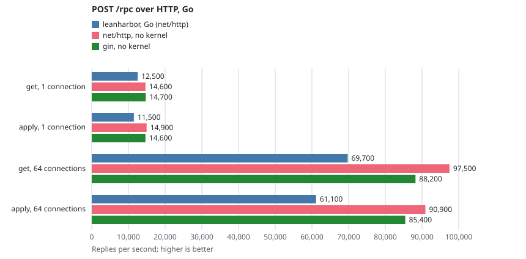

# leanharbor

Web services whose core is one pure function written and proved in Lean 4.

You write the kernel of a service — what a command does to one tenant's state — as a Lean
function, prove what callers rely on, and [leanfran](https://github.com/conao3/lean-leanfran)
generates it to your language. leanharbor is the contract the kernel fills, an authorization guard
proved once for every kernel and policy, and the shell that runs the generated code behind HTTP.
The same kernel runs today from Rust, from Python and from Go.

The design follows [h5i-app](https://github.com/h5i-dev/h5i/blob/main/crates/h5i-app/README.md),
which does this for Rust by translating Rust to Lean. leanharbor goes the other way: Lean is the
source, and the host language is generated.

## The calculator

[`lean/Calculator/Kernel.lean`](lean/Calculator/Kernel.lean) keeps one number per user:

```lean
def transition (actor : Principal) (snap : Snapshot) (cmd : Command) :
    Except Error (Option Memory × Reply) :=
  match cmd with
  | .set value => .ok (some { user := actor.user, value }, .value value)
  | .apply op arg =>
    match compute op (memoryOf snap.memories actor.user) arg with
    | .ok v => .ok (some { user := actor.user, value := v }, .value v)
    | .error e => .error e
  | .get => .ok (none, .value (memoryOf snap.memories actor.user))
```

A tenant's numbers are a binary trie on the user id, lowest bit first. A command visits at most
64 nodes, and about log₂ n in a tenant whose n user ids are 0 to n − 1. `memoryOf` reads a number and `apply` stores one with `store`.

[`lean/Calculator/Proofs.lean`](lean/Calculator/Proofs.lean) proves, for every principal, snapshot
and command:

| Theorem | Statement |
|---|---|
| `transition_spec` | the reply is `specStep` (arithmetic on unbounded naturals) of the caller's number, and the command is refused exactly when `specStep` refuses |
| `compute_spec` | `compute` is `+`, `-`, `*`, `/` on naturals when the result fits 64 bits, and a refusal otherwise |
| `get_after` | after an accepted command, `get` by the same user returns that command's reply |
| `others_unchanged` | a command leaves every other user's number as it was |
| `read_only_sound` | `get` returns no writes (the obligation `ReadOnlySound`) |
| `memoryOf_store` | after `store k v`, `memoryOf` returns `v` for `k` and what it returned before for every other id |

The Rust server is the generated kernel behind an ordinary axum router
([`rust/calculator`](rust/calculator)):

```console
$ export LEANHARBOR_SECRET=dev-secret
$ TOKEN=$(LEANHARBOR_ISSUE=1:7 cargo run --release -q --bin leanharbor-calculator)
$ LEANHARBOR_LISTEN=127.0.0.1:8080 cargo run --release -q --bin leanharbor-calculator &
$ curl -s -H "Authorization: Bearer $TOKEN" -d '{"cmd":"set","value":6}' 127.0.0.1:8080/rpc
{"value":6}
$ curl -s -H "Authorization: Bearer $TOKEN" -d '{"cmd":"apply","op":"mul","arg":7}' 127.0.0.1:8080/rpc
{"value":42}
$ curl -s -H "Authorization: Bearer $TOKEN" -d '{"cmd":"get"}' 127.0.0.1:8080/rpc
{"value":42}
$ curl -s -H "Authorization: Bearer $TOKEN" -d '{"cmd":"apply","op":"div","arg":0}' 127.0.0.1:8080/rpc
{"error":"division_by_zero"}
```

The Python server ([`python/src/leanharbor_calculator`](python/src/leanharbor_calculator)) runs
the same Lean module, generated to Python, and the Go server
([`go/calculator`](go/calculator)) runs it generated to Go. Accepted and refused commands get the
same status and body from the three servers, and a token issued by one is accepted by the others:

```console
$ cd python && LEANHARBOR_LISTEN=127.0.0.1:8081 uv run leanharbor-calculator &
$ curl -s -H "Authorization: Bearer $TOKEN" -d '{"cmd":"set","value":6}' 127.0.0.1:8081/rpc
{"value":6}
$ cd go && LEANHARBOR_LISTEN=127.0.0.1:8082 go run ./calculator/cmd/leanharbor-calculator &
$ curl -s -H "Authorization: Bearer $TOKEN" -d '{"cmd":"set","value":6}' 127.0.0.1:8082/rpc
{"value":6}
```

With `LEANHARBOR_DATABASE_URL`, the Rust, the Python and the Go servers keep the numbers in
PostgreSQL instead of their memory, and a server started again on the same database answers from
them. An administrator first runs one of them with `LEANHARBOR_LOCKDOWN=<owner>:<engine role>`
and the administrator's connection string: it creates the tables, gives them to the owner (made
without the right to log in if it does not exist), lets the engine's role (which must exist and
may not be a superuser) read and write their rows but not alter, drop or truncate them, grants it
`USAGE` and `CREATE` on the schema (PostgreSQL checks `CREATE` before it finds that a table of
`CREATE TABLE IF NOT EXISTS` exists, and the engine runs those statements at start), and exits:

```console
$ LEANHARBOR_DATABASE_URL='host=/run/postgresql user=postgres dbname=calc' \
    LEANHARBOR_LOCKDOWN=leanharbor_owner:leanharbor_engine cargo run --release -q --bin leanharbor-calculator
$ LEANHARBOR_DATABASE_URL='host=/run/postgresql user=leanharbor_engine dbname=calc' \
    LEANHARBOR_LISTEN=127.0.0.1:8083 cargo run --release -q --bin leanharbor-calculator &
$ curl -s -H "Authorization: Bearer $TOKEN" -d '{"cmd":"apply","op":"add","arg":1}' 127.0.0.1:8083/rpc
{"value":1}
$ cd python && LEANHARBOR_DATABASE_URL='host=/run/postgresql user=leanharbor_engine dbname=calc' \
    LEANHARBOR_LISTEN=127.0.0.1:8084 uv run leanharbor-calculator &
$ curl -s -H "Authorization: Bearer $TOKEN" -d '{"cmd":"apply","op":"add","arg":1}' 127.0.0.1:8084/rpc
{"value":2}
$ cd go && LEANHARBOR_DATABASE_URL='host=/run/postgresql user=leanharbor_engine dbname=calc' \
    LEANHARBOR_LISTEN=127.0.0.1:8085 go run ./calculator/cmd/leanharbor-calculator &
$ curl -s -H "Authorization: Bearer $TOKEN" -d '{"cmd":"apply","op":"add","arg":1}' 127.0.0.1:8085/rpc
{"value":3}
```

The servers can run on one database at once. They read and write the same tables and the same
table of stored replies, and fingerprint a command alike, so a reply stored under an
`Idempotency-Key` by one is replayed by another.

## Storing a kernel in PostgreSQL

A kernel declares its tables as a `List Tab` and each row type as an instance of
`Leanharbor.Row`, whose laws say that `fromRow` reads back what `toRow` writes and accepts no other
row. [`lean/Calculator/Store.lean`](lean/Calculator/Store.lean) stores the calculator's numbers in
one table keyed by the user, each `UInt64` as the `Int64` with the same bits:

```lean
def tables : List Tab := [⟨"memories", [⟨"user", .int, false⟩, ⟨"value", .int, false⟩], 1⟩]

def toRow (m : Memory) : List Val := [.int m.user.toInt64, .int m.value.toInt64]

def fromRow : List Val → Option Memory
  | [.int user, .int value] => some { user := user.toUInt64, value := value.toUInt64 }
  | _ => none

def writes : Option Memory → List Write
  | none => []
  | some m => [.put 0 1 (toRow m)]
```

`load` builds a snapshot from the rows of each table. A `Leanharbor.Storage` puts these together
with `enc`, the tenant's database a snapshot stands for, and four obligations: the schema is valid,
`init` stands for no rows, the rows an accepted write set stores turn the database of a snapshot
into that of the snapshot `apply` computes, and rows that list the database of a snapshot load to
a snapshot that stands for the same database.
[`lean/Calculator/Store/Proofs.lean`](lean/Calculator/Store/Proofs.lean) proves them for the
calculator, and [`lean/Notes/Store/Proofs.lean`](lean/Notes/Store/Proofs.lean) for the notes,
whose members and notes are two tables, with `BOOLEAN` and `TEXT` columns. The tables and the row
functions are generated to the three shells. Those of the calculator run behind the three
PostgreSQL engines, and those of the notes behind the Rust one.

The Rust engine ([`rust/leanharbor-pg`](rust/leanharbor-pg)) takes a kernel with an implementation
of `leanharbor::Storage`, which delegates `tables`, `load` and `writes` to the generated functions.
At start it creates the tables with the statements of the generated `create` and `render`. Each
command runs in one `SERIALIZABLE` transaction: the engine reads the tenant's rows of each table
with the generated `select`, builds the snapshot with `load`, calls `transition`, and sends the
statements the generated `compile` makes of the generated `plan` of each write, with the values as
parameters. Its other statements are constants of its own: the transaction control, the advisory
locks, and the framework's table `leanharbor_idempotency`, which holds the reply of each command run
under an idempotency key, per tenant, scope and key. `lockdown`, which an administrator runs, writes
statements of its own around role names it checks against `[a-z_][a-z0-9_]*` and table names quoted
by the generated `quote`. Its contract is the list at the top of
[`rust/leanharbor-pg/src/lib.rs`](rust/leanharbor-pg/src/lib.rs).

The Python engine ([`python/src/leanharbor/pg`](python/src/leanharbor/pg)) takes a
`leanharbor.Storage`, which the calculator fills with the generated `tables`, `load` and `writes`
of `store.py`. `store.py` is generated with the classes of the generated kernel and SQL compiler
(`--type-module`), so the snapshot `load` builds is the one `transition` takes, and the writes
`transition` returns are the ones `writes` takes. The engine keeps the same contract, at the top of
[`python/src/leanharbor/pg/__init__.py`](python/src/leanharbor/pg/__init__.py), with the same
statements for the advisory locks and `leanharbor_idempotency` and the same `lockdown`; it writes
its transaction control (`BEGIN ISOLATION LEVEL SERIALIZABLE`, `COMMIT`, `ROLLBACK`) itself, where
the Rust engine has tokio-postgres write it. It sends each value as a parameter of the type of its
kind (`BIGINT`, `BOOLEAN`, `TEXT`, `BYTEA`; `NULL` untyped) through psycopg's `RawCursor`, which
sends the text of `render` unchanged, and reads each column back by the OID of its type.

The Go engine ([`go/leanharbor/pg`](go/leanharbor/pg), on pgx) takes a kernel with an
implementation of `leanharbor.Storage`, which the calculator implements with the generated
`Tables`, `Load` and `Writes` of the package `store`, generated with the types of the packages
`kernel` and `sql` (`--type-module`). The engine keeps the same contract, at the top of
[`go/leanharbor/pg/pg.go`](go/leanharbor/pg/pg.go), with the statements of the Rust engine for the
transaction control, the advisory locks and `leanharbor_idempotency`, and the same `Lockdown`. It
sends each value as a parameter of the type PostgreSQL inferred, which it checks against the
value's kind, and reads each column back by the OID of its type. The pool and the connections stay
inside the package: a kernel's code gets `Execute` and no type of pgx.

## The notes

[`lean/Notes/Kernel.lean`](lean/Notes/Kernel.lean) keeps notes in an organization with members
and admins, after h5i's notes example. A note is visible to everyone if it is shared, otherwise to
its owner and admins; the owner or an admin edits and deletes it, and its owner never changes.
Admins add and remove members, and anyone may add the first member of an organization with none.

`handle` decides what each command does and checks input and existence only. It lists notes and
members in key order, so that no reply depends on the order in which a snapshot holds its rows.
The policy is the Bool functions `permits`, `visible` and `stored`, and `view`, the rows of a
snapshot the caller may see. The function the engine runs is `handle` behind the guard of
[`lean/Leanharbor/Authz.lean`](lean/Leanharbor/Authz.lean):

```lean
def transition (a : Principal) (s : Snapshot) (c : Command) :
    Except (Guarded Error) (List Write × Reply) :=
  guardViewed handle apply ⟨permits, visible, stored⟩ disclosed readOnly view a s c
```

The guard checks each write in the state the writes before it leave, and each row the reply
discloses against the state before or after the command. One refused write or row refuses the
whole command with `denied`, and nothing is stored. A read-only command runs on the caller's view,
the rows the policy lets the caller see.

[`lean/Leanharbor/AuthzProofs.lean`](lean/Leanharbor/AuthzProofs.lean) proves, for every kernel
(`transition` and `apply`), policy, disclosure, `readOnly` and `view`:

| Theorem | Statement |
|---|---|
| `guard_authorized` | a command the guard accepts is the kernel's own result, each write is permitted in the state the writes before it leave, and each disclosed row is stored, exactly as disclosed, and visible, before or after the command |
| `guard_complete` | the guard accepts every such command, and `guard_app_error`: it passes the kernel's refusals through. `guard_eq` states the three as one equation |
| `guard_viewed_authorized` | with `guardViewed`, an accepted command that writes is `guard`'s case, and an accepted read-only command is the kernel's result on the caller's view, with no writes and only rows stored and visible in the view |
| `guard_viewed_noninterference` | two states with the same view give a read-only command the same result, refusals included |
| `read_only_sound_of_viewed` | a kernel behind `guardViewed` meets `ReadOnlySound`, the read-only obligation of the kernel contract |

[`lean/Notes/Proofs.lean`](lean/Notes/Proofs.lean) applies them to the notes
(`transition_authorized`, `transition_noninterference`, `read_only_sound`) and proves, for every
principal, snapshot and command:

| Theorem | Statement |
|---|---|
| `read_after_put` | after an accepted `putNote`, the same user's `readNote` returns that body and sharing, owned by the note's earlier owner or else by the caller |
| `read_after_delete`, `member_after_add`, `member_after_remove` | after an accepted `deleteNote`, `readNote` finds no note; after `addMember`, the member is stored with its admin flag; after `removeMember`, it is gone |
| `others_unchanged` | a user who is not an admin changes only notes they own, before and after the command |
| `members_unchanged` | a user who is not an admin changes the members only of an organization that has none |
| `admin_not_denied` | the guard denies no command of an admin that writes |
| `owner_may_put`, `owner_may_delete` | the guard denies no edit or delete by a note's owner and no creation under a free id |
| `first_member` | anyone may add the first member of an organization with none |
| `read_note_spec`, `list_notes_spec`, `list_members_spec` | in a snapshot with unique keys, `readNote` returns the note under the id when the caller may see it and `notFound` otherwise, and the listings return exactly the rows the caller may see, in key order |
| `sortNotes_spec`, `sortMembers_spec` | a listing is in key order and holds each row of the list it sorts once |
| `transition_congr` | two snapshots with unique keys that store the same row under each key answer every command of every principal the same, whatever the order of their rows |
| `rows_stored_run` | every row a reply returns is the row stored under its key in the caller's view |
| `keyed_of_run` | every snapshot a tenant reaches has unique keys |
| `findNote_applyWrite`, `findMember_applyWrite` | what each write does to the row stored under each key |
| `ids_putNote`, `users_putMember` | a new row goes after the stored rows and a replaced row keeps its place |
| `bad_text` | a body is refused exactly when it is empty, longer than 4096 bytes in UTF-8, or holds NUL |
| `not_found` | removing a member or deleting a note that is not stored is refused with `notFound` |

The Rust server ([`rust/notes`](rust/notes)) answers a denied command with 403, a missing note
with 404 and a bad body with 422. It keeps the snapshots in its memory, or in PostgreSQL when
`LEANHARBOR_DATABASE_URL` is set, as the calculator does:

```console
$ export LEANHARBOR_SECRET=dev-secret
$ A=$(LEANHARBOR_ISSUE=1:1 cargo run --release -q --bin leanharbor-notes)
$ B=$(LEANHARBOR_ISSUE=1:2 cargo run --release -q --bin leanharbor-notes)
$ LEANHARBOR_LISTEN=127.0.0.1:8080 cargo run --release -q --bin leanharbor-notes &
$ curl -s -H "Authorization: Bearer $A" -d '{"cmd":"add_member","user":1,"admin":true}' 127.0.0.1:8080/rpc
{"done":true}
$ curl -s -H "Authorization: Bearer $A" -d '{"cmd":"put_note","id":7,"body":"draft","shared":false}' 127.0.0.1:8080/rpc
{"done":true}
$ curl -s -H "Authorization: Bearer $B" -d '{"cmd":"read_note","id":7}' 127.0.0.1:8080/rpc
{"error":"not_found"}
$ curl -s -H "Authorization: Bearer $B" -d '{"cmd":"put_note","id":7,"body":"mine now","shared":true}' 127.0.0.1:8080/rpc
{"error":"denied"}
$ curl -s -H "Authorization: Bearer $A" -d '{"cmd":"put_note","id":7,"body":"for everyone","shared":true}' 127.0.0.1:8080/rpc
{"done":true}
$ curl -s -H "Authorization: Bearer $B" -d '{"cmd":"read_note","id":7}' 127.0.0.1:8080/rpc
{"note":{"body":"for everyone","id":7,"owner":1,"shared":true}}
```

The same modules are generated to Python ([`python/src/leanharbor_notes`](python/src/leanharbor_notes))
and Go ([`go/notes`](go/notes)). The kernel runs behind their memory engines in the differential
tests; neither has a notes server.

## What is proved, and what is trusted

Proved in Lean, about the definitions that are generated and run:

- the six theorems above, for the calculator kernel. The three shells call `transition` and
  `apply`;
- the guard's theorems above, for every kernel and policy, and the notes theorems, for the notes
  kernel. Its `transition` is `handle` behind `guardViewed`, and the three shells call it;
- `Leanharbor.Kernel.Run.inv`: a property that holds for the initial snapshot and is kept by
  every accepted command holds in every snapshot a tenant can reach. `Obligation.Invariant.run`
  states it for a property that satisfies `Obligation.Invariant`;
- for the SQL compiler `Leanharbor.Sql` (`plan`, `compile`, `select`, `create`, `render`,
  `valid`), which is generated to the three shells and which the three PostgreSQL engines call for
  every statement on a kernel's tables:
  - `lexName_quote`: a quoted name followed by any character but `"` reads back as exactly that
    name, under PostgreSQL's rule for quoted identifiers written as a lexer on characters;
  - `compile_params`, `select_params`: the parameters of every compiled statement are the tenant
    (`$1`), then the statement's values in order;
  - `compile_placeholders`, `select_placeholders`: the compiled statement refers to `$1` … `$n`
    for its `n` parameters, each once and in order. The statement is the `Sql` value that `render`
    prints, and `render_spec` fixes the text of each part;
  - `compile_erase`, `select_erase`: the compiled statement is the same for every tenant and for
    every value of the same kinds;
  - `render_spec`, `valid_iff`, `compile_spec`, `select_spec`, `create_spec`, `plan_spec`: the
    generated functions equal definitions written another way (the text as lists of characters,
    the schema checks as propositions);
  - against the model of PostgreSQL in `Leanharbor.Sql.Model`, on tables that `create` made:
    - `compile_sound`: a compiled statement runs, the tables stay as `create` made them, the
      tenant's rows change as `exec` says, and no other tenant's rows and no table outside the
      schema change. `compileAll_sound` states the same for a list of statements;
    - `select_sound`: a compiled `SELECT` returns the tenant's rows of the table that pass the
      filter, each once, in any order. `lists_of_selects`: a `SELECT` of every table lists the
      tenant's rows;
    - `create_sound`: creating the tables of a valid schema in a database without them gives
      tables that match the schema, with no row for any tenant, and changes no other table.
      `create_kept`: tables that exist are kept as they are;
    - `tenant_isolation` (`TenantIsolation`), for every schema `valid` accepts: statements
      compiled for one tenant leave every other tenant's rows as they were, and a compiled
      `SELECT` returns the same rows, up to order, from two databases that hold the same rows for
      its tenant;
- for every kernel with a `Leanharbor.Storage`, against the same model. `Storage.Stored` is what
  an engine does to one tenant on a shared database, from tables that match the schema and hold no
  row for the tenant: load the snapshot from the rows a compiled `SELECT` of each table returned,
  run an accepted command of any principal on it, and run the statements compiled from its write
  set, with statements compiled for other tenants in between:
  - `stored_view`: the tenant's rows are those of the snapshot that `apply` computed, and the
    tables stay as `create` made them;
  - `stored_load`: loading the tenant's rows gives back a snapshot that stands for the same rows;
  - `stored_inv`: a property of `init`, kept by every accepted command, that holds for a snapshot
    when it holds for one standing for the same rows, holds for every snapshot loaded;
  - `stored_commit`: the `SELECT`s of the tables return rows, the rows load, and compiled
    statements run;
  - `create_stored`: creating the tables in a database without them starts every tenant from
    `init`;
- for the calculator's table (`Calculator.Store`: `tables`, `toRow`, `fromRow`, `writes`,
  `storeAll`, `load`), which is generated to the three shells and which the three calculator
  servers call through the PostgreSQL engines:
  - `fromRow_toRow`, `toRow_fromRow`: the laws of `Row`;
  - `writes_compile`: every write set compiles, for every tenant;
  - `enc_apply`, `load_enc`: the obligations of the calculator's `storage`, so the theorems above
    hold for the calculator;
  - `stored_lookup`, `stored_transition`: the snapshot loaded from a tenant's rows stores a number
    for the same users, with the same values, as the snapshot `apply` computed, and answers every
    command of every principal as that snapshot does. They compare the numbers the two snapshots
    hold; that the two are the same tree is not proved;
  - `stored_commit`: every commit goes through: the `SELECT` returns rows, they load, and every
    write set compiles and runs;
- for the notes' tables (`Notes.Store`: `tables`, `memberRow`, `memberOfRow`, `noteRow`,
  `noteOfRow`, `write`, `writes`, `load`), which are generated to the three shells and which the
  Rust notes server calls through the PostgreSQL engine:
  - `memberOfRow_memberRow`, `memberRow_memberOfRow`, `noteOfRow_noteRow`, `noteRow_noteOfRow`:
    the laws of `Row`;
  - `writes_compile`: every write set compiles, for every tenant;
  - `enc_apply`, `load_enc`: the obligations of the notes' `storage`, so the theorems above hold
    for the notes;
  - `stored_keyed`, `stored_load`: every snapshot an engine stores, and every snapshot it loads
    from a tenant's rows, has unique keys;
  - `stored_transition`: the snapshot loaded from a tenant's rows answers every command of every
    principal as the snapshot `apply` computed does. The two may hold their rows in different
    orders; `transition_congr` makes the replies equal;
  - `stored_authorized`: a command accepted on the snapshot loaded from a tenant's rows is
    authorized against the snapshot `apply` computed, as `transition_authorized` states it: a
    command that writes is `handle`'s result on that snapshot with every write permitted and every
    disclosed row stored and visible, and a read-only command is `handle`'s result on the caller's
    view of it, with no writes. So every write set an engine stores is one the guard permits in
    the state the tenant's rows stand for;
  - `stored_noninterference`: a read-only command of a principal gives the same result on the
    snapshots loaded from two databases, or two tenants, when the rows the principal may see stand
    for the same rows;
  - `accepted_no_nul`: no body that an accepted command writes holds NUL;
  - `stored_commit`: every commit goes through: the `SELECT`s return rows, they load, and every
    write set compiles and runs;
- for the token functions `Leanharbor.Token` (`encodePayload`, `join`, `parseString`), which the
  three servers call to issue and to read every bearer token:
  - `parseString_spec`: `parseString`, which reads a token as a `String` and returns its fields
    with the bytes in arrays, returns what `parse` returns for the bytes of the string. So the
    theorems about `parse` below hold for what the servers run, and `parseString_join`,
    `parseString_sound` and `parseString_canon` state them for `parseString`;
  - `parse_join`: parsing the token that `join` makes of `encodePayload t u e` and any signature
    gives back `t`, `u`, `e`, that payload and that signature;
  - `parse_sound`, `parse_canon`: a token that `parse` accepts is `join` of its payload and its
    signature, and the payload is `encodePayload` of the tenant, the user and the expiry that
    `parse` returns. So a token has one spelling (no leading zero, sign, uppercase hexadecimal or
    other version is accepted), and the bytes the shell checks the signature over are the bytes
    before the last dot;
  - `encodePayload_injective`: a payload determines the tenant, the user and the expiry, so a
    signature over it binds one reading;
  - `splitDot_spec`, `hexValue_spec`, `join_spec`, `value_decimal`, `number_decimal`,
    `splitDot_dotFrom`, `numberAt_spec`, `unhexAt_spec` and the others in
    `Leanharbor.Token.Proofs`: the generated helpers equal definitions written another way, or
    read back what they write.
- for the JSON writer `Leanharbor.Json` (`escape`, `write`, `writeArray`), which writes every
  JSON body that the three servers send:
  - `writeArray_spec`: `writeArray`, which takes tokens whose strings are `String`s and writes
    into an array, writes the bytes that `write` writes for the same tokens with the bytes of
    each string. So the theorems about `write` below hold for what the servers run, and
    `writeArray_value` states `write_value` for `writeArray`;
  - `write_value`: `write` of the tokens of a JSON value is `Value.print` of the value, a printer
    over the tree: `null`, `true`, `false`, numbers in decimal, quoted strings, and arrays and
    objects with their elements and members separated by commas;
  - `write_spec`: on any list of tokens, a document or not, `write` puts a comma before each token
    that follows a value and does not close an array or an object, and writes each token as
    `printToks` says;
  - `lex_escape`: a JSON string lexer that reads `escape s` and then a quote returns `s` and the
    bytes after that quote, whatever they are. So no byte of a string ends it early or changes
    what it reads as;
  - `escape_no_control`: an escaped string has no byte below 0x20;
  - `escapeByte_spec`, `tokBytes_spec`, `writeFrom_spec`, `decimal_spec`, `pushEscaped_spec`,
    `pushTok_spec` and the others in `Leanharbor.Json.Proofs`: the generated helpers equal
    definitions written another way.
- for the calculator's bodies (`encodeReplyArray`, `encodeErrorArray` in `Calculator.Kernel`),
  which the three servers send for every accepted and refused command: `encodeReplyArray_spec`
  and `encodeErrorArray_spec` say that they are `Value.print` of `{"value": v}` and of
  `{"error": name}`, with the names `overflow`, `underflow` and `division_by_zero`, as
  `encodeReply_spec` and `encodeError_spec` say of `encodeReply` and `encodeError`. The shells'
  own bodies (401, 400, a reused idempotency key, a stopped engine) are the tokens of
  `{"error": message}`, which each shell builds from the message, written by `writeArray` in
  Rust and Python and by `write` in Go, where `WriteArray` returns an error for a string that is
  not UTF-8.

Checked by `make check`, not proved:

- **The theorems state the framework's statements.** `Leanharbor.Obligation` fixes statements
  that have the same form for every kernel: `ReadOnlySound k writes` (whenever `readOnly c` is
  `true` and `transition` accepts `c`, `writes` of the write set is empty) and `Invariant k I`
  (`I` holds for `init` and is kept by every accepted command). `#obligations k`
  ([`audit/Audit/Obligations.lean`](audit/Audit/Obligations.lean)) fails the build unless a
  theorem's type is definitionally equal, in Lean's kernel, to `ReadOnlySound k _`, and to
  `Invariant k I` for each `I` listed after `invariant`, and that theorem depends only on
  `propext`, `Classical.choice` and `Quot.sound`. It searches the theorems of the file and of the
  imported modules outside `Init`, `Std`, `Lean` and `Lake`. The write list is the kernel's
  choice: the check prints it, and a list that is always empty would pass. For the calculator,
  `#obligations Calculator.Kernel.kernel` finds `read_only_sound` with the write list
  `fun w => w.toList`; the calculator lists no invariant. For the notes,
  `#obligations Notes.Kernel.kernel invariant Notes.Kernel.Keyed` finds `read_only_sound` with the
  write list `fun ws => ws` and `keyed_invariant` (no two members share a user id and no two notes
  an id). The PostgreSQL engines rely on `ReadOnlySound`: they run a command that `readOnly`
  marks, sent without an idempotency key, in a read-only transaction, and fail it if its write set
  stores a row (item 6 of their contract). The memory engines run every command the same way.
  `make check` also builds the files in [`audit/fail/`](audit/fail), a kernel without the
  theorem, with a theorem that has one more hypothesis, with a listed invariant that no theorem
  states, and with an invariant left as a hole, and requires each to fail with the check's error;
- **The theorems constrain the kernel.** [leanassay](https://github.com/conao3/lean-leanassay)
  breaks functions in small ways and runs the theorems on each broken version. For the
  calculator, it breaks `transition`, `apply`, `compute` and the three functions of the trie in
  167 ways: 132 are rejected, 5 behave the same on every input tried, 30 do not compile, and none
  satisfies every theorem while changing an output. The same holds for the 26 functions of the SQL
  compiler (285 ways: 241 rejected, 6 behave the same, 38 do not compile), the 20 functions of
  the token format (453 ways: 387 rejected, 15 behave the same, 51 do not compile), the 15
  functions of the JSON writer (524 ways: 454 rejected, 6 behave the same, 64 do not compile), the
  8 functions that make the calculator's bodies (111 ways, all rejected), the 6 functions of the
  calculator's table (25 ways: 20 rejected, 5 do not compile) and the 8 functions of the notes'
  tables (46 ways: 30 rejected, 16 do not compile). For the guard, it breaks `guard`, `guardViewed` and the four checks in 28 ways and runs `guard_eq`,
  `guard_viewed_eq` and the lemmas about the checks on random kernels and policies: 22 are
  rejected, 1 behaves the same, 5 do not compile, and none satisfies every theorem while changing
  an output. For the notes, it breaks `handle`, `apply`, `applyWrite`, `textOk`, the four
  functions on the row lists, the four functions that sort the listings and the seven functions of
  the policy in 217 ways: 141 are rejected, 5 behave the same, 71 do not compile, and none
  satisfies every theorem while changing an output.
  The notes' `transition` is one call of `guardViewed`, and no edit of it compiles.
- **The tables, as PostgreSQL receives them.** `tables_create` evaluates, in Lean's kernel, the
  text of the statements that create them. For the calculator:
  `CREATE TABLE IF NOT EXISTS "memories" ("tenant_id" BIGINT NOT NULL, "user" BIGINT NOT NULL, "value" BIGINT NOT NULL, PRIMARY KEY ("tenant_id", "user"))`.
  For the notes:
  `CREATE TABLE IF NOT EXISTS "members" ("tenant_id" BIGINT NOT NULL, "user" BIGINT NOT NULL, "admin" BOOLEAN NOT NULL, PRIMARY KEY ("tenant_id", "user"))`
  and
  `CREATE TABLE IF NOT EXISTS "notes" ("tenant_id" BIGINT NOT NULL, "id" BIGINT NOT NULL, "owner" BIGINT NOT NULL, "shared" BOOLEAN NOT NULL, "body" TEXT NOT NULL, PRIMARY KEY ("tenant_id", "id"))`.
- **The generated code computes what Lean computes.** 5,000 calculator commands (698 refusals,
  values up to 2^64 − 1) and 3,000 notes commands (1,826 refusals: 1,383 denied by the guard, 336
  not found, 107 bodies refused; bodies of characters of 1 to 4 bytes, up to and past 4096 bytes)
  run through the generated Rust, the generated Python and the generated Go give the same output
  as the kernels compiled natively by Lean. 3,024 lines of schemas and statements
  (1,189 compiled statements, 1,481 refused ones, names with `"`, non-ASCII and NUL, values up to
  the bounds of 64 bits) give the same SQL text and parameters in the generated Rust, Python and
  Go as in the compiler compiled natively by Lean. 3,000 token lines (985 issued tokens, 845
  accepted and 1,170 rejected ones: edited bytes, leading zeros, signs, numbers of 2^64 and more,
  uppercase hexadecimal, missing and extra fields) give the same fields and bytes in the generated
  Rust, Python and Go as in the token functions compiled natively by Lean, and the 1,916 tokens
  to read that are UTF-8 give the same through `parseString` (Go's `ParseString` refuses the
  others). 3,000 token lists (1,627 of them JSON documents; 4,903 strings and keys, of which 1,505
  hold control bytes, 257 a `"`, 265 a `\`, 2,992 bytes above 0x7f and 1,436 bytes that are not
  UTF-8) give the same bytes in the generated Rust, Python and Go as in the writer compiled
  natively by Lean, and the 2,107 lists whose strings are UTF-8 give the same through
  `writeArray`. The Go and the Python table functions of the notes are generated and compiled, a
  Python test imports them and runs their `load` on a few rows, and no differential test runs
  them.
- **PostgreSQL stores and reads the rows as the model says.** The same 5,000 calculator commands
  run through the Rust PostgreSQL engine, on a server that the tests start in a temporary
  directory, give the same output as through the memory engine and as in Lean. Along the
  same commands, which mix three tenants, each command leaves every row but its own user's as it
  was (`rust/calculator/tests/postgres.rs`). Values of every kind, `NULL` included, at the bounds
  of 64 bits, text with quotes and characters outside ASCII and bytes 0 to 255, in a table and
  columns whose names hold `"`, read back as written; a text holding NUL, which PostgreSQL cannot
  store, fails the command (`rust/leanharbor-pg/tests/values.rs`). A calculator server started
  again on the same database answers from the rows the first one stored. The same holds for the
  Python engine and the generated Python table functions behind it
  (`python/test/test_pg_calculator.py`, `python/test/test_pg_values.py`). There, tenants of 2^63
  and more are stored under the `Int64` with the same bits, and the 15 principals of the command
  list each run their commands from a thread of their own, with and without the advisory lock, and
  get the replies Lean gives. The Rust and the Python calculator servers run on one database at
  once: the 5,000 commands go to them in turn and get the replies Lean gives, and a reply stored
  under an idempotency key by either server is replayed by the other and refused with another
  command. The same holds for the Go engine and the generated Go table functions behind it
  (`go/calculator/postgres_test.go`, `go/leanharbor/pg/values_test.go`, which reads the values
  back before and after a row is replaced, and stores empty bytes from a `nil` slice and from an
  empty one as empty bytes and not as `NULL`). The Rust and the Go calculator servers run on one
  database whose tables the Rust server's `LEANHARBOR_LOCKDOWN` made: the 5,000 commands go to
  them in turn and get the replies Lean gives; every tenth carries an idempotency key and is sent
  again with that key to the other server, which answers alike (from the stored reply for the 424
  accepted ones) and refuses the key with another command; at the end both answer `get` alike for
  every user. No test runs the Python and the Go servers on one database. The 3,000 notes commands run through the Rust PostgreSQL engine give the same output
  as through the memory engine and as in Lean, listings and denials included
  (`rust/notes/tests/differential.rs`). Along them, which mix two tenants, each of the 1,826
  refused commands (1,383 denied by the guard) and of the 849 accepted read-only commands leaves
  every row of both tables as it was, and every other command leaves the other tenant's rows as
  they were (`rust/notes/tests/postgres.rs`). A body holding NUL is refused on both engines and
  writes no row. The stored form of each of the 1,174 replies of the list reads back as the reply,
  and a repeated keyed request gets the stored reply. A notes server started again on the same
  database answers from the rows the first one stored.
- **The PostgreSQL engines keep their contract.**
  [`rust/leanharbor-pg/tests/contract.rs`](rust/leanharbor-pg/tests/contract.rs) runs a small
  kernel written in Rust through the Rust engine,
  [`python/test/test_pg_contract.py`](python/test/test_pg_contract.py) one written in Python
  through the Python engine, and [`go/leanharbor/pg/contract_test.go`](go/leanharbor/pg/contract_test.go)
  one written in Go through the Go engine, each with a hook the engine calls at three points of
  each attempt and a proxy that loses a COMMIT. Each Python test has the name of the Rust test
  with `test_` in front, and each Go test that name in camel case with `Test` in front
  (`TestSerializationFailuresRetryInANewTransaction`); each checks the same, except where the last
  two columns say:

  | Item of the contract | Tests | Python | Go |
  |---|---|---|---|
  | 1. one attempt, one `SERIALIZABLE` transaction | `serialization_failures_retry_in_a_new_transaction` (three attempts, each `serializable` and read-write, with distinct virtual transaction ids) | the same | the same |
  | 2. retries in a new transaction, at most 20 attempts | `serialization_failures_retry_in_a_new_transaction` (two forced 40001s: each retry reads the outside commits), `serialization_failures_exhaust_after_max_attempts`, `deadlocks_are_retried` (a real 40P01 between the advisory lock and a row lock), `killed_before_commit_retries_once` (the backend terminated at each point, with and without a key: one effect, on a new connection; without a key, a backend terminated just before COMMIT gives `CommitUnknown` and no effect) | the same | the same |
  | 3. a refusal rolls back | `refusals_write_nothing` (no row, no stored reply; the key runs the command once it is accepted) | the same | the same |
  | 4. writes and reply commit together | `replies_commit_with_the_writes` (COMMIT lost before: neither; after: both), `idempotency_keys_replay_and_conflict`, `concurrent_requests_with_one_key_run_once` (32 clients, with and without the lock: one commit, 31 replays) | the same, with 32 threads | the same, with 32 goroutines |
  | 5. advisory lock before `BEGIN`, released before the pool | `advisory_lock_is_held_around_the_transaction` (a queued request waits before reading the table, then reads the first commit without a retry), `advisory_locks_are_released` (after a commit, a refusal, a terminated backend, a failed request and a caller that stopped waiting) | the caller that stops waiting is an HTTP client of `leanharbor.serve` that closes its connection while its request waits before COMMIT | the caller that stops waiting is an HTTP client of `RpcHandler` that closes its connection while its request waits before COMMIT |
  | 6. read-only commands | `read_only_path` (`SERIALIZABLE READ ONLY DEFERRABLE`, no advisory lock, retried after a terminated backend, a command that claims to read only and writes fails, a keyed read takes the write path) | the same | the same |
  | 7. COMMIT lost without a key | `lost_commit_without_key_is_unknown` (`CommitUnknown`, not retried; one case committed, one did not), `lost_commit_with_key_runs_once` | first ten commands on the proxy's one connection, more than the five after which psycopg prepares a statement it runs again, so the engine's COMMIT is still a simple query the proxy sees | the same |
  | with `SERIALIZABLE`, commits are serial | `concurrent_moves_are_serial` (64 clients, 512 moves between four cells, with and without the lock: every cell holds what the accepted moves left) | the same, with 64 threads | the same, with 64 goroutines |
  | the roles | `roles_keep_the_engine_to_rows` (the tables belong to a role that cannot log in; the engine's role cannot alter, drop or truncate them; a superuser is refused as the engine's role) | the same | the same |

  A caller that stops waiting (a closed HTTP connection) does not cancel its command: the Rust
  engine runs the request in a task of its own to its end, the Python engine runs it on the thread
  of the HTTP request, which a closed connection does not stop, and the Go engine's `Execute` takes
  no context and runs on the goroutine of the HTTP request to its end. Its advisory lock is
  released, and it may commit. Not tested: a restart of the database server while clients write,
  a crash of the host, network delays short of a closed connection, and a full table of
  serializable conflicts (53200), which the engines retry. The Rust engine connects without TLS;
  the Python and the Go engines use TLS as the connection string's `sslmode` says (the default of
  libpq and of pgx is `prefer`).
- **The Rust notes server answers the guard's refusals with 403.** `rust/notes/tests/http.rs`
  sends denied writes, a read of a note the caller may not see (404) and a bad body (422).
- **The code that runs is generated from the proved source.** The build regenerates the three
  targets and fails on a difference from the committed files.
- **No extra axioms.** Every theorem depends only on `propext`, `Classical.choice` and
  `Quot.sound`.

Trusted, with no theorem. The Rust, Python and Go shells are written by hand, and every row
holds for each of them:

| | Trusted |
|---|---|
| Translation | leanfran's Rust, Python and Go backends and their runtimes, rustc, CPython, the Go compiler, Lean's kernel |
| Engine | the memory engine: one command at a time per process, under one lock (Rust, Python), or per tenant, under the tenant's lock and in its `leanfran.Region` (Go); replies stored per idempotency key. The PostgreSQL engines: the seven items of their contract, PostgreSQL's `SERIALIZABLE` (its commits equal a serial order) and its deferrable read-only snapshot, the conversion of values to parameters and of columns back to values, the stored form of replies (`Storage::encode_reply` and `decode_reply`, `Storage.encode_reply`: eight bytes for the calculator, the JSON body read back with serde_json for the notes), and that the engine's role is not a superuser and does not own the tables. In Rust, tokio-postgres and deadpool-postgres, and each value a parameter of the type PostgreSQL inferred. In Python, psycopg and the libpq it bundles, the engine's pool, each value a parameter of the type of its kind, and that the generated Python computes what Lean computes when several threads call it at once, as the PostgreSQL engine does and the memory engine, under its lock, does not. In Go, pgx and pgxpool, which take the `PG*` environment variables as the defaults of the connection string, each value a parameter of the type PostgreSQL inferred, and that the generated Go computes what Lean computes when several goroutines call it at once, as the PostgreSQL engine does for its requests and the memory engine for different tenants, each in a `leanfran.Region` of its own |
| Authentication | HMAC-SHA256 and the constant-time comparison of tags, the secret and its storage, the system clock and the expiry check, reading the token from the `Authorization` header, the table of accepted tokens (a token accepted once is recognised by its exact bytes and only its expiry is checked again) |
| Wire format | JSON decoding of commands (`Api`); the fingerprint of a command under an idempotency key (`Api`; the Python and the Go calculators write the bytes of the Rust calculator's, its `Debug` form); that the shells send the bytes of `encodeReplyArray` and `encodeErrorArray` as the body; the tokens each shell builds for its own `{"error": ...}` bodies |
| HTTP | axum, hyper and tokio (Rust); `http.server` (Python); `net/http` (Go) |
| Call site | that a shell runs the notes' `transition`. `handle`, the kernel without the guard, is generated and public too, and the guard's theorems say nothing about a caller of `handle` |
| SQL | that PostgreSQL reads the text as `lexName_quote`'s lexer reads a quoted name; that PostgreSQL, sent `render q` with its parameters, fails or does to the tables what `run` says, and that a `SELECT` returns the rows `selected` says in some order (`ORDER BY` is not modeled); that values compare as Lean values do (text character by character, bytes byte by byte); that the tables were made by `create` of the same schema, since `CREATE TABLE IF NOT EXISTS` keeps a table of that name as it is; that no text holds NUL, which the model stores and PostgreSQL refuses (for the notes, `accepted_no_nul` proves it of every body an accepted command writes) |
| Storage | that the PostgreSQL engines do what `Storage.Stored` says: each creates `tables` in a database without them, loads each commit's snapshot with `load` from the rows of the compiled `SELECT` of each table, and runs the statements compiled from `writes` of the accepted write set for the principal's tenant (`Kernel.tenant`, as the `Int64` with the same bits). The code that does it is `rust/leanharbor-pg/src/lib.rs`, `python/src/leanharbor/pg/__init__.py` and `go/leanharbor/pg/pg.go`, and the `Storage` of the calculator in Rust, in Python and in Go and of the notes in Rust, which delegate to the generated functions; the differential tests and the contract tests check it |
| Specification | that `specStep` and the statements above say what a calculator and the notes should do; that the write list a kernel gives `ReadOnlySound` (`fun w => w.toList` for the calculator) holds every write of its write set; that `Valid`, `Accepts`, `sqlOf`, `renderSpec`, `exec`, `view`, `Sel` and `Lists` say what the SQL compiler should do; that `TenantIsolation`, `Storage`, `Loaded` and `Stored` say what storing a kernel should mean; that the calculator's `lookup` and `enc` and the notes' `enc` and `encTable` say which rows a snapshot stands for, and that `SameRows` says when two snapshots differ only in the order of their rows; that `v1.<tenant>.<user>.<expiry>.<hex>` with the signature over the bytes before the last dot is the token a client should sen; that `Value.print` and `printToks` print JSON as RFC 8259 defines it, and `lexStr` reads a string as RFC 8259 does for the escapes `write` uses; that `replyValue` and `errorValue` are the bodies a client should read |
| Policy | that `permits`, `visible`, `stored`, `view`, `disclosed` and `readOnly` of the notes say who should see and change what: the guard enforces them as written |

The Python and Go notes kernels run only in the differential tests; only Rust has a notes server.
The Rust, the Python and the Go calculator servers and the Rust notes server have a PostgreSQL
engine; without `LEANHARBOR_DATABASE_URL` a server keeps the state in its memory, where it is lost
on restart.

## Speed

Measured on a cloud VM with 4 virtual CPUs (Intel Xeon, 2.30 GHz) and 16 GB of memory by
`tools/measure.py`, which runs every measurement alone and writes the runs to
[`docs/speed.json`](docs/speed.json). `tools/speed-charts.py` draws the charts and prints the
tables from that file. Every number is a rate, so higher is better. All numbers come from one
run of the program: the same measurement on another VM of this kind differs by up to 2 times, so
compare rows within this section only.

### One command through the kernel

Commands per second through `transition` and `apply`. Each cell is the inverse of the median
time of three runs; the runs of one cell differ by up to 1.3 times. M is a million.


| Commands per second | 1 user | 100 users | 1,000 users | 10,000 users |
|---|---:|---:|---:|---:|
| Rust, generated kernel, snapshot as a Rust value | 10.9 M | 117,700 | 10,800 | 480 |
| Rust, generated kernel, snapshot as a Lean value | 11.6 M | 7.52 M | 6.58 M | 4.44 M |
| Rust, memory engine | 9.01 M | 6.33 M | 5.75 M | 3.91 M |
| Rust, a HashMap by hand (not proved) | 43.5 M | 38.5 M | 41.7 M | 43.5 M |
| Go, memory engine | 1.4 M | 1.26 M | 1.11 M | 887,300 |
| Python, memory engine | 63,100 | 48,300 | 41,900 | 35,800 |

### Over HTTP, next to servers without a kernel

Replies per second to `POST /rpc` on the same VM, with `oha` for 8 seconds against a tenant of
one user. Each cell is the mean of two runs, and every reply had status 200. The load generator
runs on the same four CPUs as the server. Every request carries the same token, so after the
first request the server recognises the token by its bytes and checks only its expiry.

The servers marked "no kernel" ([`bench/`](bench)) are the usual servers of each language doing
the least a JSON endpoint does: they decode the JSON body and reply with a JSON value. They check
no token, hold no state and call no kernel, so the difference from a leanharbor row is what the
token check, the engine and the generated kernel cost.


| Replies per second, Rust | get, 1 connection | apply, 1 connection | get, 64 connections | apply, 64 connections |
|---|---:|---:|---:|---:|
| leanharbor, Rust (axum) | 21,900 | 21,800 | 195,400 | 165,500 |
| axum, no kernel | 21,700 | 21,400 | 183,600 | 175,200 |
| actix-web, no kernel | 22,200 | 22,500 | 245,500 | 254,500 |



| Replies per second, Go | get, 1 connection | apply, 1 connection | get, 64 connections | apply, 64 connections |
|---|---:|---:|---:|---:|
| leanharbor, Go (net/http) | 16,500 | 15,600 | 94,300 | 75,200 |
| net/http, no kernel | 13,200 | 12,200 | 96,800 | 97,000 |
| gin, no kernel | 13,200 | 14,100 | 93,900 | 88,200 |


| Replies per second, Python | get, 1 connection | apply, 1 connection | get, 64 connections | apply, 64 connections |
|---|---:|---:|---:|---:|
| leanharbor, Python (http.server) | 7,520 | 6,290 | 4,340 | 3,630 |
| FastAPI on uvicorn, 4 processes, no kernel | 7,670 | 7,730 | 32,000 | 31,400 |
| Flask on gunicorn, 4 processes, no kernel | 4,080 | 4,390 | 9,520 | 9,920 |

- The Rust shell runs on axum and gives as many replies as axum without a kernel: 101% on one
  connection and 106% on 64, where the two runs of a cell differ by up to 8%.
- The Go shell runs on `net/http`. On 64 connections it gives 97% of the replies of `net/http`
  without a kernel to `get` and 78% to `apply`. On one connection it gave more in this run
  (16,500 against 13,200); the servers are measured minutes apart, and the two runs of gin on one
  connection differ by 1.3 times.
- The Python shell is one process on `http.server`, with one lock around the engine. On one
  connection it gives as many replies as FastAPI. On 64 connections it gives fewer than on one,
  while FastAPI and Flask spread the connections over four processes.
- Every body is written by the generated JSON writer.

A generated function that takes a Rust, Python or Go value converts it to Lean's representation on
every call, and its result back. The engines therefore keep each tenant's snapshot as a Lean
value with one owner (`leanfran::Owned<Snapshot>`, `leanfran.Local`, `leanfran.Value[Snapshot]`)
and convert only the principal, the command and the reply; `apply` receives the only reference
to the snapshot and Lean updates it in place.

The Rust memory engine keeps the snapshots under one lock and runs each command on the thread
that calls it: an `Owned` moves between threads with its lock, and lends the snapshot to one
command at a time. A test (`rust/calculator/tests/in_place.rs`) sends commands from several
threads, some of them refused, and checks that the snapshot is still the kind of Lean object
that is updated in place.

The row written by hand keeps the numbers in a `HashMap` and has no proof. It runs 5 times as
many commands as the Rust memory engine for one user, 6 times for 100, 7 times for 1,000 and 11
times for 10,000. The difference is the allocation of the small Lean objects of each call and the
walk down the trie.

The row with the snapshot as a Rust value converts the whole trie on every call, so it falls with
the number of users; the engines do not use it.

The Go memory engine gives each tenant a lock and a `leanfran.Region` of its own, and holds the
tenant's snapshot in a `leanfran.Value` of that region: the commands of one tenant run one at a
time and those of different tenants in parallel, and a lock held only to look a tenant up guards
the table of tenants. The kernel's calls for a command run in `region.WithValues` through
`kernel.Handle.In(scope)`, and `apply` receives the snapshot with `Take()`. A test
(`go/calculator/in_place_test.go`) sends commands from several goroutines, some of them refused,
and checks that the snapshot still has one reference (`IsExclusive`). Another
(`go/calculator/concurrent_test.go`, and the same for the notes) runs the shared command list on
24 tenants at once (16 for the notes) and checks every reply against Lean's, then closes the
engine and checks with `leanfran.TrackLeakedValues` that no value was dropped while it held a
Lean reference.

### Stored in PostgreSQL

The Rust PostgreSQL engine, on a PostgreSQL server that `tools/measure.py` starts on the same VM
with its default settings, on a Unix socket, after the other measurements and only for these;
its version, the settings that decide the cost of a commit (`fsync`, `synchronous_commit`) and
the file system of its data directory are in `versions` of [`docs/speed.json`](docs/speed.json).
Every commit that writes waits for PostgreSQL to flush its log.

Commands per second through the engine's `execute`, one command at a time on one connection, by
the benchmark of [`rust/calculator`](rust/calculator) with `LEANHARBOR_DATABASE_URL`. Every
command reads all the rows of its tenant in one `SERIALIZABLE` transaction, so the rate falls with
the number of users. Each cell is the inverse of the median time of three runs, each on a new
database. The memory engine's row is the one of the table above.


| Commands per second, PostgreSQL | 1 user | 100 users | 1,000 users | 10,000 users |
|---|---:|---:|---:|---:|
| Rust, PostgreSQL engine | 1,580 | 1,320 | 589 | 83 |
| Rust, memory engine | 9.01 M | 6.33 M | 5.75 M | 3.91 M |

Replies per second to `POST /rpc`, as above, from the Rust calculator server with
`LEANHARBOR_DATABASE_URL` and from a server without a kernel on axum and tokio-postgres
([`bench/rust/src/bin/axum_postgres.rs`](bench/rust/src/bin/axum_postgres.rs)), each with a pool
of 16 connections and a database of its own. The server without a kernel does the least the same
replies take on the same table: `get` reads the user's row with one `SELECT` in a
`SERIALIZABLE READ ONLY DEFERRABLE` transaction, and `apply` writes it with one upsert in a
`SERIALIZABLE` transaction, retried after a serialization failure until it commits. It checks no
token and takes no advisory lock. The leanharbor server checks the token, reads the rows of the
tenant, runs the kernel and sends the generated statements, and takes the tenant's advisory lock
around each write, so its writes to one tenant wait for each other instead of failing and
retrying.


| Replies per second, PostgreSQL | get, 1 connection | apply, 1 connection | get, 64 connections | apply, 64 connections |
|---|---:|---:|---:|---:|
| leanharbor, Rust (axum), PostgreSQL engine | 3,980 | 1,060 | 20,600 | 1,300 |
| axum and tokio-postgres, no kernel | 4,460 | 2,140 | 23,900 | 2,020 |

- The leanharbor server gives 89% of the replies of the server without a kernel to `get` on one
  connection and 86% on 64, and 50% and 64% to `apply`.
- A commit that writes waits for the log to reach the disk, so `apply` gives 1,000 to 2,100
  replies per second on either server, on one connection and on 64: all the requests write to
  one tenant.

## Layout

| Path | Contents |
|---|---|
| [`lean/`](lean) | the Lake package: `Leanharbor` (the kernel contract, the obligations, the SQL compiler, a model of PostgreSQL, tenant isolation, the storage of a kernel, the token format, the JSON writer, the authorization guard, and their proofs), `Calculator` (kernel, table and proofs), `Notes` (kernel, policy, tables and proofs), `calculator-oracle`, `notes-oracle`, `sql-oracle` and `token-oracle`, `json-oracle` (the kernel, the SQL compiler and the token format as native programs) |
| [`audit/`](audit) | the leanassay audits, the axiom check and the obligation check, with the files that must fail it (`fail/`) |
| [`rust/leanharbor`](rust/leanharbor) | the Rust shell: `Kernel`, `Storage`, `MemoryEngine`, tokens, `POST /rpc`, the generated SQL compiler, token format and JSON writer (`src/generated/`) |
| [`rust/leanharbor-pg`](rust/leanharbor-pg) | the PostgreSQL engine, `lockdown` (the owner and the engine's role), the contract tests and the test server (`testing`) |
| [`rust/calculator`](rust/calculator) | the generated kernel and table (`src/generated/`), the server, the benchmark, the differential and PostgreSQL tests |
| [`rust/notes`](rust/notes) | the generated notes kernel and tables (`src/generated/`), the server, the HTTP, differential and PostgreSQL tests |
| [`python/`](python) | the Python shell (`leanharbor`, with the generated `sql.py`, `token_format.py` and `json_format.py`, and `leanharbor.pg`: the PostgreSQL engine, `lockdown` and the test server `testing`), the calculator (`leanharbor_calculator`, with the generated `kernel.py` and `store.py`), the notes (`leanharbor_notes`, with the generated `kernel.py` and `store.py`), and the tests (`test/`, among them the PostgreSQL engine's contract tests) |
| [`go/leanharbor`](go/leanharbor) | the Go shell: `Kernel`, `Storage`, `MemoryEngine`, tokens, `POST /rpc`, the generated SQL compiler (`sql/`), token format (`token/`) and JSON writer (`jsonformat/`) |
| [`go/leanharbor/pg`](go/leanharbor/pg) | the PostgreSQL engine, `Lockdown` (the owner and the engine's role), the contract tests and the test server (`pgtest/`) |
| [`go/calculator`](go/calculator) | the generated kernel (`kernel/`) and table (`store/`), the server and the benchmark (`cmd/`), the differential and PostgreSQL tests |
| [`go/notes`](go/notes) | the generated notes kernel (`kernel/`) and tables (`store/`), the differential test |
| [`bench/`](bench) | servers without a kernel (axum, actix-web, `net/http`, gin, FastAPI, Flask, and axum with tokio-postgres) for the HTTP comparison |
| [`docs/`](docs) | the measured runs (`speed.json`) and the charts drawn from them |
| [`testdata/`](testdata) | the command lists (`tools/gen-commands.py`, `tools/gen-notes-commands.py`), the statement list (`tools/gen-statements.py`) , the token list (`tools/gen-tokens.py`) and the JSON token lists (`tools/gen-json.py`) of the differential tests |

## Development

```sh
nix develop --command make check   # format, proofs, audit, generation, Rust, Python and Go tests
nix develop --command make bench
nix run                            # the Rust calculator server
```

`make generate` rewrites the generated Rust, Python and Go from `lean/`. The PostgreSQL tests
start a server of their own with `initdb` and `pg_ctl` from the devShell, in a directory under
`/tmp` that is removed when the test process exits. `make python` and `make go` build the Rust
calculator server, which the Python and the Go tests run next to their own on a shared database.

## License

[Apache-2.0](LICENSE). The SQL compiler is based on h5i; see [`NOTICE`](NOTICE).
