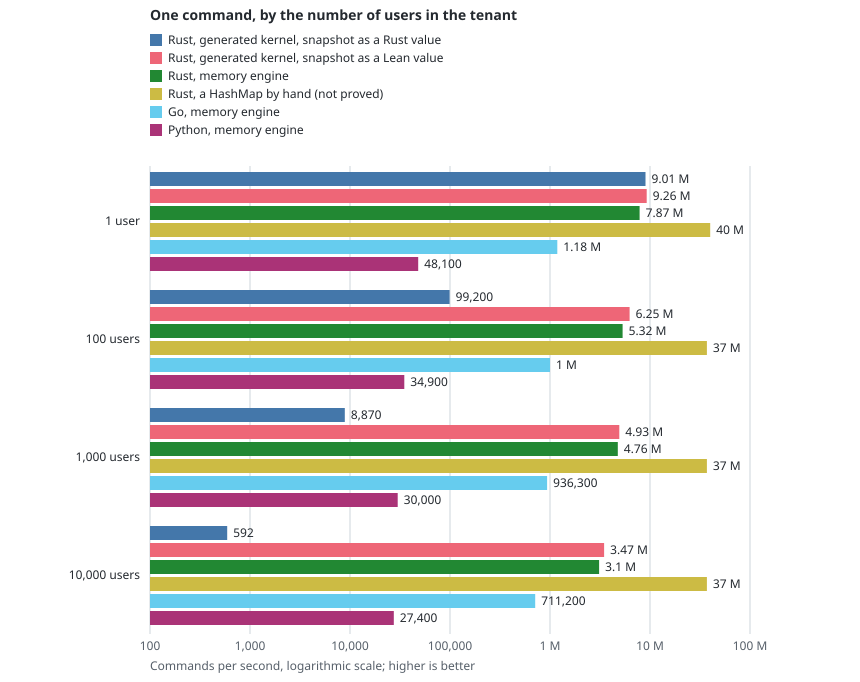
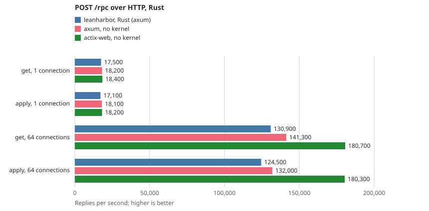
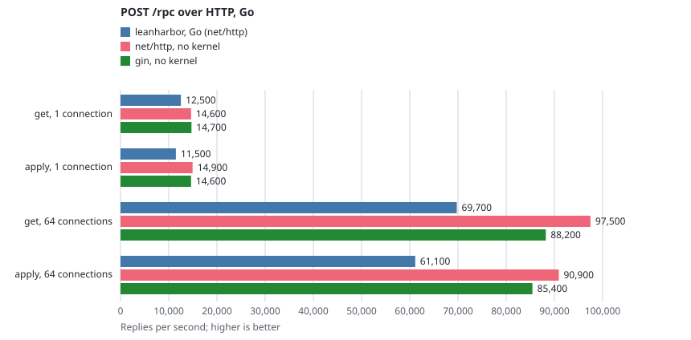
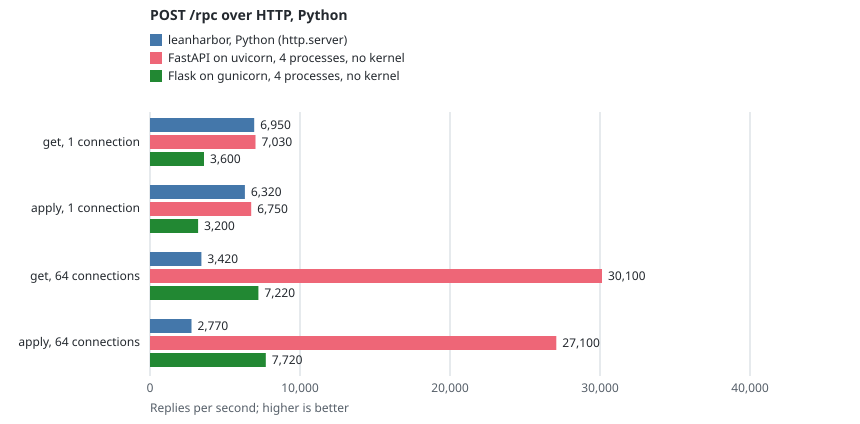
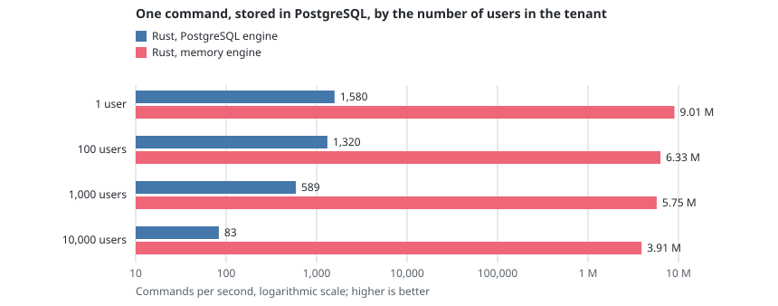
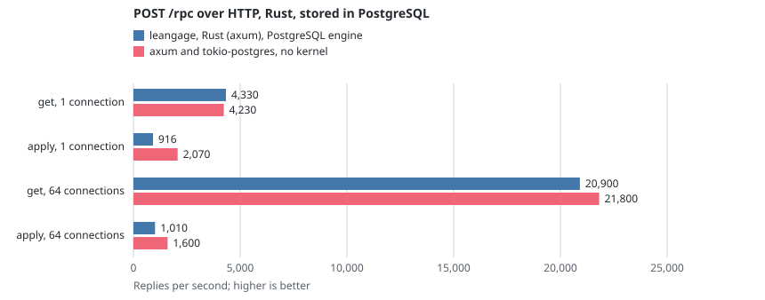

# Speed

Measured on a cloud VM with 4 virtual CPUs (Intel Xeon, 2.10 GHz) and 16 GB of memory by
`tools/measure.py`, which runs every measurement alone and writes the runs to
[`docs/speed.json`](speed.json). `tools/speed-charts.py` draws the charts and prints the
tables from that file. Every number is a rate, so higher is better. All numbers come from one
run of the program: the same measurement on another VM of this kind differs by up to 2 times, so
compare rows within this section only.

### One command through the kernel

Commands per second through `transition` and `apply`. Each cell is the inverse of the median
time of 3 runs; the runs of one cell differ by up to 1.7 times. M is a million.

| Commands per second | 1 user | 100 users | 1,000 users | 10,000 users |
|---|---:|---:|---:|---:|
| Rust, generated kernel, snapshot as a Rust value | 9.62 M | 103,000 | 9,660 | 529 |
| Rust, generated kernel, snapshot as a Lean value | 10.6 M | 6.49 M | 5.49 M | 4 M |
| Rust, memory engine | 8.33 M | 5.68 M | 4.93 M | 3.51 M |
| Rust, a HashMap by hand (not proved) | 40 M | 38.5 M | 37 M | 38.5 M |
| Go, memory engine | 1.3 M | 1.12 M | 1 M | 832,600 |
| Python, memory engine | 48,800 | 37,200 | 33,900 | 29,600 |

### Over HTTP, next to servers without a kernel

Replies per second to `POST /rpc` on the same VM, with `oha` for 8 seconds against a tenant of
one user. Each cell is the mean of 2 runs, and every reply had status 200. The load generator
runs on the same 4 CPUs as the server. Every request carries the same token, so after the
first request the server recognises the header by its bytes and computes no HMAC.

The servers marked "no kernel" ([`bench/`](../bench)) are the usual servers of each language doing
the least a JSON endpoint does: they decode the JSON body and reply with a JSON value. They check
no token, hold no state and call no kernel, so the difference from a leangage row is what the
token check, the engine and the generated kernel cost.

| Replies per second, Rust | get, 1 connection | apply, 1 connection | get, 64 connections | apply, 64 connections |
|---|---:|---:|---:|---:|
| leangage, Rust (axum) | 18,800 | 19,000 | 141,700 | 140,500 |
| axum, no kernel | 19,800 | 19,600 | 151,000 | 149,800 |
| actix-web, no kernel | 19,500 | 19,200 | 199,100 | 202,100 |

| Replies per second, Go | get, 1 connection | apply, 1 connection | get, 64 connections | apply, 64 connections |
|---|---:|---:|---:|---:|
| leangage, Go (net/http) | 11,700 | 11,700 | 71,700 | 67,800 |
| net/http, no kernel | 12,800 | 12,800 | 96,400 | 92,400 |
| gin, no kernel | 13,100 | 13,000 | 80,600 | 77,100 |

| Replies per second, Python | get, 1 connection | apply, 1 connection | get, 64 connections | apply, 64 connections |
|---|---:|---:|---:|---:|
| leangage, Python (http.server) | 5,130 | 4,450 | 2,610 | 2,370 |
| FastAPI on uvicorn, 4 processes, no kernel | 6,460 | 6,240 | 25,700 | 26,900 |
| Flask on gunicorn, 4 processes, no kernel | 3,340 | 2,980 | 7,600 | 7,520 |

- The Rust server runs on axum and gives 95% of the replies of axum without a kernel to `get` on
  one connection and 94% on 64, and 97% and 94% to `apply`.
- The Go server runs on `net/http` and gives 91% of the replies of `net/http` without a kernel to
  `get` on one connection and 74% on 64, and 92% and 73% to `apply`.
- The Python server is one process on `http.server`, with one lock around the engine. On one
  connection it gives 79% of the replies of FastAPI to `get` and 71% to `apply`. On 64
  connections it gives fewer than on one, while FastAPI and Flask spread the connections over 4 processes.
- The 2 runs of a cell differ by up to 6% in the Rust table, 14% in the Go table and 12% in the
  Python table.
- Every body is read by the JSON library of the server's language, and every request is decided
  and every reply is made by the generated functions. Reading the body
  `{"cmd":"apply","op":"mul","arg":7}` and deciding the request takes about 0.4 µs in Rust, 1.4 µs
  in Go and 46 µs in Python on a 6-core desktop, with or without spaces in the body
  (`make bench-bytes`, line (d)): 2.5 million calls per second in Rust, 730,000 in Go and 21,600
  in Python, beside 2.17 million, 586,000 and 131,000 for a decoder written by hand. The library
  and the conversion file take 0.24 µs, 0.57 µs and 6 µs of it, and the generated `request`
  0.12 µs, 0.72 µs and 31 µs. A body crosses into the generated code as one text: a request
  answered before its body is decoded (an expired token) takes about 0.07 µs in Rust, 0.35 µs in
  Go and 13 µs in Python. Line (f) of
  `make bench-bytes` calls the server's `/rpc` handling in process (token check, body, generated
  `request`, engine, `respond`) for the `get` and the `apply` body of the tables above, and so
  shows what a request costs the server apart from the socket: 2.2 µs and 2.5 µs in Rust, 3.8 µs
  and 4.7 µs in Go (40 and 46 allocations), 86 µs and 112 µs in Python.

A generated function that takes a Rust, Python or Go value converts it to Lean's representation on
every call, and its result back. The engines therefore keep each tenant's snapshot as a Lean
value with one owner (`leanfran::Owned<Snapshot>`, `leanfran.Local`, `leanfran.Value[Snapshot]`)
and convert only the principal, the command and the reply; `apply` receives the only reference
to the snapshot and Lean updates it in place.

The Rust memory engine keeps the snapshots under one lock and runs each command on the thread
that calls it: an `Owned` moves between threads with its lock, and lends the snapshot to one
command at a time. A test (`samples/rust/calculator/tests/in_place.rs`) sends commands from several
threads, some of them refused, and checks that the snapshot is still the kind of Lean object
that is updated in place.

The row written by hand keeps the numbers in a `HashMap` and has no proof. It runs 5 times as
many commands as the Rust memory engine for one user, 7 times for 100, 8 times for 1,000 and 11
times for 10,000. The difference is the allocation of the small Lean objects of each call and the
walk down the trie.

The row with the snapshot as a Rust value converts the whole trie on every call, so it falls with
the number of users; the engines don't use it.

The Go memory engine gives each tenant a lock and a `leanfran.Region` of its own, and holds the
tenant's snapshot in a `leanfran.Value` of that region: the commands of one tenant run one at a
time and those of different tenants in parallel, and a lock held only to look a tenant up guards
the table of tenants. The kernel's calls for a command run in `region.WithValues` through
`kernel.Handle.In(scope)`, and `apply` receives the snapshot with `Take()`. A test
(`samples/go/calculator/in_place_test.go`) sends commands from several goroutines, some of them
refused, and checks that the snapshot still has one reference (`IsExclusive`). Another
(`samples/go/calculator/concurrent_test.go`, and the same for the notes) runs the shared command
list on 24 tenants at once (16 for the notes) and checks every reply against Lean's, then closes the
engine and checks with `leanfran.TrackLeakedValues` that no value was dropped while it held a
Lean reference.

### Stored in PostgreSQL

The Rust PostgreSQL engine, on a PostgreSQL server that `tools/measure.py` starts on the same VM
with its default settings, on a Unix socket, after the other measurements and only for these;
its version, the settings that decide the cost of a commit (`fsync`, `synchronous_commit`) and
the file system of its data directory are in `versions` of [`docs/speed.json`](speed.json).
Every commit that writes waits for PostgreSQL to flush its log.

Commands per second through the engine's `execute`, one command at a time on one connection, by
the benchmark of [`samples/rust/calculator`](../samples/rust/calculator) with
`LEANGAGE_DATABASE_URL`. Every command runs in one `SERIALIZABLE` transaction. The engine remembers
the tenant's snapshot with its version, reads the version row, and reads the rows of the tenant only
when another writer moved the version, so the rate doesn't fall with the number of users. Each cell
is the inverse of the median time of 3 runs, each on a new database. The memory engine's row is the
one of the table above.

| Commands per second, PostgreSQL | 1 user | 100 users | 1,000 users | 10,000 users |
|---|---:|---:|---:|---:|
| Rust, PostgreSQL engine | 1,350 | 1,420 | 1,500 | 1,370 |
| Rust, memory engine | 8.33 M | 5.68 M | 4.93 M | 3.51 M |

Replies per second to `POST /rpc`, as above, from the Rust calculator server with
`LEANGAGE_DATABASE_URL` and from a server without a kernel on axum and tokio-postgres
([`bench/rust/src/bin/axum_postgres.rs`](../bench/rust/src/bin/axum_postgres.rs)), each with a pool
of 16 connections and a database of its own. The server without a kernel does the least the same
replies take on the same table: `get` reads the user's row with one `SELECT` in a
`SERIALIZABLE READ ONLY DEFERRABLE` transaction, and `apply` writes it with one upsert in a
`SERIALIZABLE` transaction, retried after a serialization failure until it commits. It checks no
token and takes no advisory lock. The leangage server checks the token, reads the rows of the
tenant, runs the kernel and sends the generated statements, and takes the tenant's advisory lock
around each write, so its writes to one tenant wait for each other instead of failing and
retrying.

| Replies per second, PostgreSQL | get, 1 connection | apply, 1 connection | get, 64 connections | apply, 64 connections |
|---|---:|---:|---:|---:|
| leangage, Rust (axum), PostgreSQL engine | 4,330 | 916 | 20,900 | 1,010 |
| axum and tokio-postgres, no kernel | 4,230 | 2,070 | 21,800 | 1,600 |

- The leangage server gives 102% of the replies of the server without a kernel to `get` on one
  connection and 96% on 64, and 44% and 63% to `apply`. The 2 runs of a cell differ by up to
  23%. An `apply` of the leangage server takes
  the advisory lock, reads and moves the version row and stores the row; the server without a
  kernel sends one upsert.
- A commit that writes waits for the log to reach the disk, so `apply` gives 900 to 2,100
  replies per second on either server, on one connection and on 64: all the requests write to
  one tenant.
